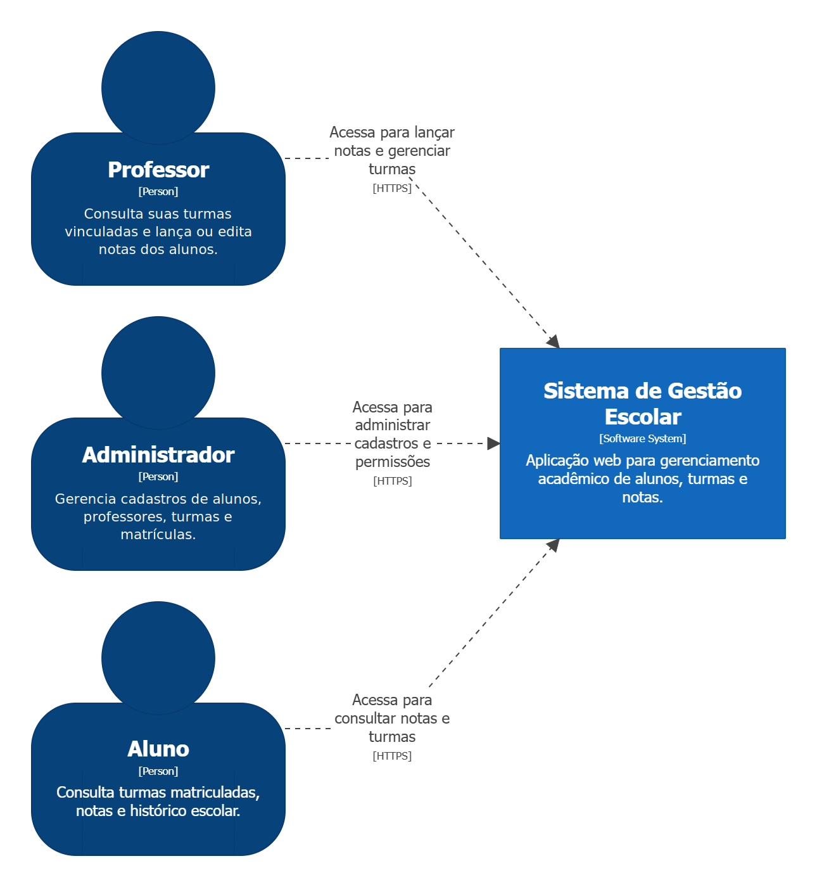
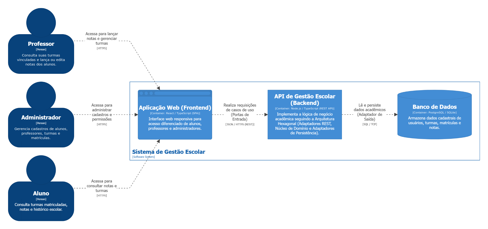
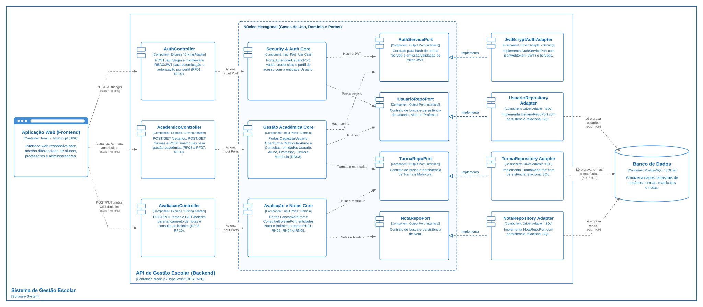
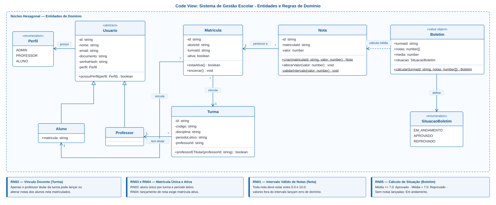
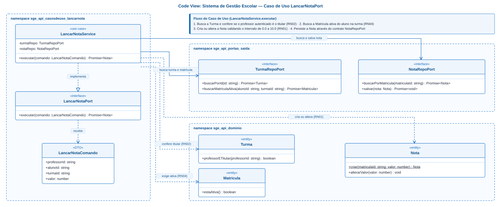

# Sistema de Gestão Escolar

Trabalho Final da disciplina **Arquitetura de Software (2026.2)** — Universidade Federal do Ceará (UFC) — **Equipe 5**.

Aplicação web para a rotina acadêmica de uma instituição de ensino, projetada segundo a **Arquitetura Hexagonal (Ports and Adapters)** e documentada com o **modelo C4 (Structurizr)**.

- **Domínio sorteado:** Tema 7 — Sistema de Gestão Escolar
- **Estilo arquitetural:** Arquitetura Hexagonal (Ports and Adapters)

## Equipe

| Integrante | Matrícula | Responsabilidade principal |
|---|---|---|
| Cícero Higor de Medeiros Carnaúba | 574228 | Documento de visão (estruturação e revisão) |
| Emilly Wictoria Pinheiro Ferreira | 567253 | Documento de funcionalidades |
| Gabriel Ribeiro de Sousa | 567908 | Diagrama de Container e documento de entrega (decisão arquitetural) |
| Kawan Torres Lopes | 563869 | Diagramas |
| Layssa da Silva de Oliveira | 564923 | Documento de visão (redação) |
| Mel Barbosa Mello | 571597 | README, Issues do GitHub e revisão do documento de funcionalidades |

> A divisão detalhada das atividades está nas **Issues** deste repositório.

## Sobre o sistema

O foco é centralizar o fluxo acadêmico básico entre secretaria, professores e alunos: cadastro de usuários, criação de turmas, efetivação de matrículas, lançamento de notas e consulta de boletim escolar.

### Perfis de acesso

| Perfil | Pode | Restrições |
|---|---|---|
| **Administrador** (`ADMIN`) | Cadastrar alunos e professores, criar turmas (código, disciplina, período letivo e professor titular), matricular alunos e listar registros | Não realiza lançamento de notas |
| **Professor** (`PROFESSOR`) | Consultar suas turmas vinculadas com lista de alunos matriculados e lançar/editar notas | Não cria turmas, não cadastra usuários e não acessa turmas de outros professores |
| **Aluno** (`ALUNO`) | Consultar suas turmas ativas e visualizar o boletim (notas, média e situação) | Acesso somente leitura aos próprios dados |

### Funcionalidades (Requisitos Funcionais)

| ID | Funcionalidade | Perfil |
|---|---|---|
| RF01 | Autenticação de Usuário (Login via e-mail/matrícula e senha com token JWT) | Todos |
| RF02 | Autorização por Perfil (restrição de rotas e casos de uso por papel) | Todos |
| RF03 | Cadastrar Usuários (Alunos e Professores) | Administrador |
| RF04 | Cadastrar Turma (código, disciplina, período letivo e professor responsável) | Administrador |
| RF05 | Matricular Aluno em Turma | Administrador |
| RF06 | Listar Alunos, Professores e Turmas | Administrador |
| RF07 | Listar Turmas Vinculadas (com alunos matriculados) | Professor |
| RF08 | Lançar e Editar Notas | Professor |
| RF09 | Consultar Turmas Matriculadas | Aluno |
| RF10 | Visualizar Boletim Acadêmico (notas, média e situação) | Aluno |

### Regras de negócio

- **RN01 — Intervalo válido de notas:** toda nota deve estar entre `0,0` e `10,0`.
- **RN02 — Vínculo obrigatório do professor:** apenas o professor titular da turma pode lançar ou alterar notas daquela turma.
- **RN03 — Unicidade de matrícula:** um aluno não pode ser matriculado mais de uma vez na mesma turma e período letivo.
- **RN04 — Pré-requisito de matrícula para nota:** só é permitido lançar notas para alunos com matrícula ativa na turma.
- **RN05 — Cálculo de situação no boletim:** *Aprovado* (média ≥ 7,0), *Reprovado* (média < 7,0) ou *Em andamento* (sem notas lançadas).

### Fluxos principais

1. **Administrador:** login → cadastra professor e aluno → cria turma vinculada ao professor → matricula o aluno na turma.
2. **Professor:** login → consulta suas turmas vinculadas → abre a turma e lança a nota do aluno matriculado.
3. **Aluno:** login → acessa o boletim acadêmico → visualiza nota, média e situação na disciplina.

## Arquitetura

A aplicação segue a **Arquitetura Hexagonal (Ports and Adapters)**, isolando as regras acadêmicas de frameworks e do banco de dados.

- **Domínio (núcleo):** entidades e invariantes de negócio (`Aluno`, `Professor`, `Turma`, `Matrícula`, `Nota`), sem dependência de framework web ou driver de banco.
- **Portas de entrada (Input / Driving Ports):** contratos dos casos de uso (ex.: `CriarTurmaPort`, `MatricularAlunoPort`, `LancarNotaPort`, `ConsultarBoletimPort`, `ConsultarTurmasPort`), acionados por adaptadores primários (Controllers REST).
- **Portas de saída (Output / Driven Ports):** interfaces de persistência e autenticação (ex.: `UsuarioRepoPort`, `AuthServicePort`, `TurmaRepoPort`, `MatriculaRepoPort`, `NotaRepoPort`), implementadas por adaptadores secundários (banco relacional e serviço JWT).

### Containers (C4 — nível 2)

| Container | Tecnologia | Responsabilidade |
|---|---|---|
| Aplicação Web (Frontend) | React / TypeScript (SPA) | Interface gráfica no navegador para os três perfis (comunicação via HTTPS/JSON) |
| API de Gestão Escolar (Backend) | Node.js / TypeScript (REST API) | Casos de uso e regras de negócio no núcleo hexagonal + adaptadores REST e SQL |
| Banco de Dados | PostgreSQL (ou SQLite em dev) | Persistência de usuários, perfis, turmas, matrículas e notas |

### Endpoints REST previstos

| Fluxo / RF | Endpoint | Perfil |
|---|---|---|
| Autenticação (RF01) | `POST /auth/login` | Público |
| Cadastro de Usuários (RF03) | `POST /usuarios` | `ADMIN` |
| Criação e Listagem de Turmas (RF04, RF06, RF07) | `POST /turmas` · `GET /turmas` | `ADMIN` / `PROFESSOR` |
| Matrícula de Aluno (RF05) | `POST /matriculas` | `ADMIN` |
| Lançamento de Notas (RF08) | `POST /notas` · `PUT /notas/:id` | `PROFESSOR` |
| Consulta de Boletim (RF09, RF10) | `GET /boletim` | `ALUNO` |

### Diagramas (C4)

Os códigos-fonte dos diagramas ficam em [`docs/`](docs/) e as imagens renderizadas em [`docs/img/`](docs/img/), exibidas diretamente abaixo:

- [x] **Nível 1 — Contexto** ([PNG](docs/img/contexto.png) · [Google Drive](https://drive.google.com/file/d/1yu138ALJhnlcqqYpGP0vzdT3wPmIysaD/view?usp=sharing) · [DSL](docs/workspace.dsl))
- [x] **Nível 2 — Containers** ([PNG](docs/img/containers.png) · [Google Drive](https://drive.google.com/file/d/1UgPXfaxJO6yNx2u8hJ4T4mLIaPUNipiF/view?usp=sharing) · [DSL](docs/workspace.dsl))
- [x] **Nível 3 — Componentes** ([SVG](docs/img/componentes.svg) · [PNG](docs/img/componentes.png) · [DSL](docs/workspace.dsl))
- [x] **Nível 4 — Código (Entidades e Regras de Domínio)** ([SVG](docs/img/codigo-dominio.svg) · [PNG](docs/img/codigo-dominio.png) · [Mermaid `.mmd`](docs/codigo-dominio.mmd))
- [x] **Nível 4 — Código (Caso de Uso `LancarNotaPort`)** ([SVG](docs/img/codigo-lancar-nota.svg) · [PNG](docs/img/codigo-lancar-nota.png) · [Mermaid `.mmd`](docs/codigo-lancar-nota.mmd))

#### C1 — Diagrama de Contexto

[](docs/img/contexto.png)

#### C2 — Diagrama de Containers

[](docs/img/containers.png)

#### C3 — Diagrama de Componentes (Arquitetura Hexagonal)

[](docs/img/componentes.svg)

#### C4 — Diagrama de Código: Entidades e Regras de Domínio

[](docs/img/codigo-dominio.svg)

#### C4 — Diagrama de Código: Caso de Uso `LancarNotaPort`

[](docs/img/codigo-lancar-nota.svg)

## Estrutura do repositório

```text
.
├── README.md
├── docs/
│   ├── workspace.dsl                 # Fonte Structurizr DSL (C1, C2 e C3)
│   ├── codigo-dominio.mmd            # Fonte Mermaid C4 — Entidades e Regras de Domínio
│   ├── codigo-lancar-nota.mmd        # Fonte Mermaid C4 — Caso de Uso LancarNotaPort
│   └── img/                          # Imagens exportadas dos diagramas (PNG e SVG)
│       ├── contexto.png              # Diagrama C1 — Contexto
│       ├── containers.png            # Diagrama C2 — Containers
│       ├── componentes.{svg,png}     # Diagrama C3 — Componentes (Arquitetura Hexagonal)
│       ├── codigo-dominio.{svg,png}  # Diagrama C4 — Entidades e Regras de Domínio
│       └── codigo-lancar-nota.{svg,png} # Diagrama C4 — Caso de Uso LancarNotaPort
├── backend/                          # API Node.js / TypeScript (Arquitetura Hexagonal)
│   └── src/
│       ├── core/
│       │   ├── domain/               # Entidades (Usuario, Turma, Matricula, Nota) e DomainError
│       │   ├── ports/
│       │   │   ├── in/               # Input Ports (contratos dos casos de uso)
│       │   │   └── out/              # Output Ports (contratos de repositórios e auth)
│       │   └── usecases/             # Implementações dos casos de uso
│       ├── adapters/
│       │   ├── inbound/http/         # Rotas REST, middleware RBAC e tratador de erros
│       │   └── outbound/             # Persistência SQL (SQLite/PostgreSQL) e JWT/bcrypt
│       └── main/                     # Composição de dependências (app.ts) e servidor
└── frontend/                         # Aplicação web React / TypeScript (Vite SPA)
    └── src/
        ├── components/               # Layout principal e guarda de rotas por perfil
        ├── contexts/                 # Contexto de sessão e autenticação
        ├── pages/                    # Telas separadas por perfil (admin, professor, aluno)
        └── services/                 # Cliente HTTP com envio automático de Bearer JWT
```

## Como executar

Pré-requisitos: **Node.js 20+** e **npm**. Por padrão em desenvolvimento, a API utiliza **SQLite** automaticamente (sem necessidade de subir banco externo), podendo alternar para **PostgreSQL** via `.env`.

### 1. Backend (API — porta `3333`)

```bash
cd backend
cp .env.example .env
npm install
npm run dev
```

Teste de saúde da API: `GET http://localhost:3333/health`

### 2. Frontend (SPA — porta `5173`)

Em outro terminal:

```bash
cd frontend
cp .env.example .env
npm install
npm run dev
```

Acesse no navegador: `http://localhost:5173`

## Cronograma

| Data | Entrega |
|---|---|
| 16/11 e 17/11 | Equipe alinhada, app e funcionalidades documentados, estilo arquitetural, repositório criado, diagramas de Contexto e Container |
| 23/11 e 24/11 | Diagramas de Componentes e Código |
| 01/12, 07/12 e 08/12 | Código rodando, conformidade com os diagramas e apresentação para a turma |

## Documentos do projeto

- [Sistema de Gestão Escolar (SGE) — Documento Unificado (Visão, Funcionalidades, Decisão Arquitetural e C4)](https://docs.google.com/document/d/1CdxFBy4iiEE1bsGDHWTYpxofOFxN5htDREQ7_m_QvFA/edit)
